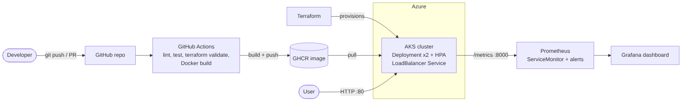

# 🎵 Song Genre Predictor: End-to-End MLOps on Azure

A small but complete ML project: it predicts a song's genre (edm, latin, pop, r&b, rap, rock)
from Spotify audio features such as danceability, energy, loudness, tempo and valence. It
trains and compares three models, serves the best one through a Streamlit app, and ships it
with a full DevOps toolchain. **To deploy on Azure, follow [DEPLOY_AZURE.md](DEPLOY_AZURE.md).**

Data: 5,400 tracks (900 per genre) sampled from the public TidyTuesday *Spotify songs* dataset,
stored in `data/spotify_tracks.csv`.



| Requirement | Where |
|---|---|
| Git / GitHub | PR workflow, `.github/` |
| GitHub Actions CI/CD | `.github/workflows/ci.yml` (lint, tests + coverage, `terraform validate`, push to GHCR) and `deploy.yml` (manual deploy to AKS) |
| Docker image | `Dockerfile` (non-root, health check), `docker-compose.yml` for the local full stack |
| Kubernetes | `k8s/`: Deployment (2 replicas, probes, resource limits), LoadBalancer Service, HPA |
| Terraform | `terraform/`: resource group + autoscaling AKS cluster, variables, outputs |
| Prometheus + Grafana | custom app metrics, `ServiceMonitor`, alert rules, pre-built dashboard in `monitoring/` |
| Streamlit on Azure | the app, running on AKS behind a public IP |

## The ML part
`train.py` runs 5-fold CV on logistic regression, random forest and histogram gradient boosting,
selects the best by macro-F1 (random forest, about 0.52 CV and 53% test accuracy; random
guessing on six genres is about 17%, and genres like pop/r&b genuinely overlap), evaluates it on
a held-out test set (accuracy, macro precision/recall/F1, ROC-AUC, per-genre F1, confusion matrix,
permutation importance) and saves `model.joblib` and `metrics.json`.
The app has four tabs: **Predict** (10 sliders, or pick a real held-out track to fill them in
and compare with its actual genre), **Batch (CSV)** upload with download,
**Model performance**, and **About**.

Custom Prometheus metrics (`:8000/metrics`): `predictions_total{label}`,
`prediction_latency_seconds`, `prediction_confidence`, `batch_rows_total`, `app_errors_total{kind}`.

## 1. Run locally
```bash
make install       # pip install -r requirements-dev.txt
make test          # trains the model, runs pytest + coverage (`make lint` for ruff)
make run           # app http://localhost:8501, metrics http://localhost:8000/metrics
```

## 2. Full stack locally (app + Prometheus + Grafana): best fallback demo
```bash
docker compose up --build
```
App http://localhost:8501, Prometheus http://localhost:9090 (Status → Targets),
Grafana http://localhost:3000 (admin / admin) → Dashboards → ML → *ML App Overview*.
In the app, open **Batch (CSV)**, download the sample CSV and upload it a few times
(or click Predict) to watch the panels move.

## 3. Git + GitHub
```bash
git init && git add . && git commit -m "feat: ML app with full MLOps pipeline"
git branch -M main
git remote add origin https://github.com/<you>/mlproject.git
git push -u origin main
```
Demo tip: `git checkout -b feature/tweak`, push, open a PR, show the CI checks, then merge.
After the first push to `main`, the image appears under your profile → Packages.
**Make the package public** (Package settings → Change visibility) so AKS can pull it without credentials.

## 4. GitHub Actions
No secrets are needed for CI: it pushes to GHCR with the built-in `GITHUB_TOKEN`.
Optional `deploy.yml` needs the `AZURE_CREDENTIALS` secret (command in the file header).

## 5. Terraform: Azure infrastructure
```bash
az login
cd terraform
cp terraform.tfvars.example terraform.tfvars    # optional
terraform init && terraform plan && terraform apply     # ~5-10 min
az aks get-credentials -g mlproject-rg -n mlproject-aks  # also printed as an output
```
If the VM size has no quota in your region/subscription, change `vm_size` or `location`.
**AKS costs money while running. Run `make tf-destroy` after your demo.**

## 6. Deploy the app to Kubernetes
```bash
make k8s-deploy GH_USER=<your-github-username>
kubectl get svc mlapp --watch      # wait for EXTERNAL-IP, then open http://<ip>
```

## 7. Prometheus + Grafana on the cluster
```bash
make monitoring-install            # kube-prometheus-stack via Helm (release name "monitoring")
make k8s-monitoring                # ServiceMonitor, alert rules, dashboard ConfigMap
make grafana                       # prints the admin password and port-forwards to :3000
```
Open http://localhost:3000 → Dashboards → *ML App Overview*. Check Prometheus targets with
`kubectl port-forward svc/monitoring-kube-prometheus-prometheus 9090` → Status → Targets.

## No Azure access? Use a local cluster
```bash
minikube start
docker build -t ghcr.io/me/mlapp:latest . && minikube image load ghcr.io/me/mlapp:latest
make k8s-deploy GH_USER=me     # change imagePullPolicy to IfNotPresent for the local image
minikube service mlapp
```

## What to screenshot for the submission
1. GitHub repo, a merged PR, and a green Actions run
2. GHCR package (Docker image)
3. `terraform apply` output and the resource group in the Azure portal
4. `kubectl get pods,svc,hpa`
5. The live app on the public IP (Predict and Model performance tabs)
6. Prometheus targets page (UP) and the Grafana dashboard with data

## Troubleshooting
- **ImagePullBackOff**: the GHCR package is still private, or the image has not been pushed yet.
- **No data in Grafana**: Prometheus → Status → Targets must show `mlapp` UP. The ServiceMonitor label `release: monitoring` must match your Helm release name.
- **EXTERNAL-IP stays `<pending>`**: wait 2-3 minutes; check `kubectl describe svc mlapp`.

## Sharing / submitting (professor has no Docker)
A Docker image can't run without Docker, so submit these instead:
1. **Live URL** of the app on Azure (`http://<EXTERNAL-IP>`), kept up until it is graded.
2. **GitHub repo link** (code, Actions history, Dockerfile, Terraform, k8s, monitoring).
3. **Screenshots** (list above) and ideally a **short screen recording** of the whole flow.
4. **Run without Docker** (needs Python 3.11+): unzip, then double-click/run `run.bat` (Windows)
   or `./run.sh` (Mac/Linux), and open http://localhost:8501.
5. If a grader does have Docker: `docker pull ghcr.io/<you>/mlapp:latest`, or share an offline
   copy made with `docker save mlapp:v1 | gzip > mlapp-v1.tar.gz` (load with `docker load < mlapp-v1.tar.gz`).
